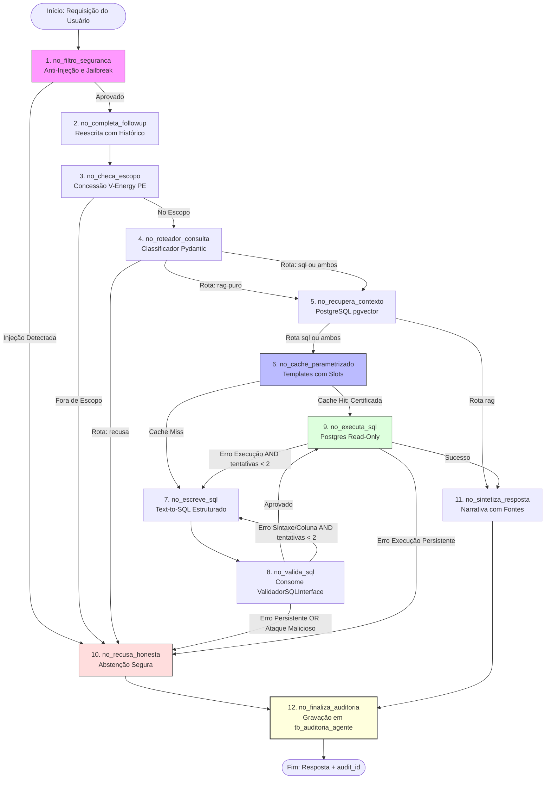

# Decisões de Arquitetura do Agente de IA (V-Energy Grid 360)

Este documento registra as decisões arquiteturais (ADRs), o diagrama de fluxo do LangGraph, o plano de implementação em fatias verticais e a matriz de riscos e alinhamentos para o módulo de Inteligência Artificial da plataforma **V-Energy Grid 360** (Visagio Rocket Lab 2026.2).

---

## 1. Registro de Decisões Arquiteturais (ADRs)

### ADR-01: Framework de Orquestração — LangGraph Determinístico
- **Contexto:** Necessidade de construir um agente de Text-to-SQL e RAG para o setor elétrico que seja auditável, testável e sem loops infinitos de custo ou alucinação.
- **Decisão:** Utilização do **LangGraph** estruturado como um grafo determinístico com nós atômicos tipados (Pydantic/TypedDict).
- **Alternativas Descartadas:** Agentes ReAct livres (LangChain AgentExecutor / CrewAI) por gerarem custo imprevisível, latência alta e comportamento não-determinístico diante de diretoria. PydanticAI isolado descartado para manter paridade com a experiência dos repositórios de base (`treino_case` e `CineData`).
- **Consequência:** Fluxo previsível, total controle de retries, facilidade de mock de nós individuais e rastreabilidade passo a passo.

### ADR-02: Desacoplamento da Validação de Segurança via Interface (`Protocol`)
- **Contexto:** A frente de Segurança desenvolverá o validador avançado com AST e SQLGlot, enquanto a frente de Agentes precisa codar imediatamente sem bloqueios.
- **Decisão:** Criação da interface abstrata `ValidadorSQLInterface` (`typing.Protocol`), implementada inicialmente por um `StubValidadorSQL` local (checagem de `SELECT`, rejeição de DDL/DML e validação de views permitidas).
- **Alternativas Descartadas:** Esperar a entrega do módulo de segurança ou acoplar o grafo diretamente a uma versão inacabada de SQLGlot.
- **Consequência:** Desenvolvimento paralelo 100% autônomo. O encaixe final requer apenas substituir a classe instanciada no grafo.

### ADR-03: Contrato com a Frente de Testes via Função Pura Pydantic
- **Contexto:** A frente de Testes precisa rodar o Golden Set automatizado, medir acurácia semântica e executar CI sem depender de subir servidor web ou interface gráfica.
- **Decisão:** Exposição da função pública `executar_agente(pergunta, historico, sessao_id) -> RespostaAgente`.
- **Alternativas Descartadas:** Forçar o time de testes a bater em endpoints HTTP com `TestClient` do FastAPI ou depender de scripts Streamlit.
- **Consequência:** Testes de regressão em lote ultrarrápidos, execução limpa via CLI e independência total da camada de transporte web.

### ADR-04: Estrutura de Pastas e Arquitetura de Nós Atômicos
- **Contexto:** Arquivos monolíticos de grafos dificultam a manutenção e testes isolados.
- **Decisão:** Organização em `ai-agent/src/nos/`, onde cada um dos 12 nós do grafo possui arquivo próprio com nomenclatura auto descritiva em português (`no_filtro_seguranca.py`, `no_completa_followup.py`, `no_cache_parametrizado.py`, etc.).
- **Alternativas Descartadas:** Agrupar nós em um arquivo genérico `nodes.py` ou `utils.py`.
- **Consequência:** Máxima clareza para a banca avaliadora, isolamento de escopo e facilidade para criar testes unitários nó a nó.

### ADR-05: Estratégia de Provedores com Fallback e Teto Rígido de Chamadas
- **Contexto:** Garantir alta disponibilidade durante a demonstração para a banca e evitar custos descontrolados de API.
- **Decisão:** Seleção dos melhores modelos disponíveis via **OpenRouter** (primário) com fallback automático para **9router** caso ocorra timeout (> 12s) ou erro de API. Temperatura 0.0 para SQL e nós de decisão; temperatura 0.2 para síntese textual. Teto rígido de **5 chamadas de LLM por requisição**.
- **Alternativas Descartadas:** Depender de um único provedor comercial ou rodar sem circuit breaker de chamadas.
- **Consequência:** Zero risco de tela preta por indisponibilidade momentânea de API e blindagem absoluta contra loops de gasto.

### ADR-06: Persistência do RAG e da Memória no PostgreSQL (pgvector + PostgresSaver)
- **Contexto:** Necessidade de armazenar conhecimento regulatório (PRODIST Módulo 8), dicionário da camada Gold e histórico de sessões em ambiente corporativo realista.
- **Decisão:** Utilização do **PostgreSQL** com a extensão **pgvector** para busca vetorial de documentos e metadados, e **PostgresSaver** nativo do LangGraph para o checkpointer de memória de curto prazo.
- **Alternativas Descartadas:** ChromaDB em arquivo local (descartado após entrevista por preferência por ambiente de produção padrão de mercado).
- **Consequência:** Arquitetura unificada no banco relacional corporativo, facilitando o deploy e a governança de dados.

### ADR-07: Memória de Curto Prazo com Janela Deslizante e Bypass de 1ª Pergunta
- **Contexto:** Atender ao requisito diferencial de perguntas de follow-up (REQ-AI-07) sem estourar o contexto do LLM.
- **Decisão:** Janela deslizante limitada aos **últimos 3 turnos** da sessão. Na primeira pergunta da conversa (`len(historico) == 0`), o nó de follow-up faz **bypass de LLM** (`pergunta_autonoma = pergunta_original`), consumindo 0 tokens.
- **Alternativas Descartadas:** Enviar histórico ilimitado da conversa ou sempre disparar chamada de reescrita mesmo para perguntas iniciais.
- **Consequência:** Redução drástica de latência na primeira interação e resolução precisa de pronomes sem poluição de contexto.

### ADR-08: Memória de Longo Prazo Estritamente Curada (Conformidade LGPD)
- **Contexto:** O repositório do projeto é público e os dados da distribuidora são confidenciais.
- **Decisão:** A memória persistente global do sistema armazena **apenas** conhecimento técnico curado (termos de glossário homologados e templates de perguntas certificadas). É estritamente **proibida a auto-ingestão de conversas de usuários** no espaço vetorial global.
- **Alternativas Descartadas:** Gravar automaticamente todo histórico de chat em coleções vetoriais compartilhadas.
- **Consequência:** Risco zero de vazamento de dados de clientes (LGPD) entre sessões e imunidade contra contaminação da base com alucinações passadas (*data poisoning*).

### ADR-09: Cache Parametrizado por Extração de Slots (Templates Determinísticos)
- **Contexto:** Perguntas como "Faturamento de Olinda em 2024" e "Faturamento de Jaboatão em 2024" possuem similaridade vetorial superior a 90%, gerando risco crítico de colisão de dados no cache.
- **Decisão:** Implementação de cache de templates parametrizados baseado em catálogo fechado de entidades da concessão (14 municípios, 4 classes tarifárias, anos 2021-2024). Em caso de match de esqueleto, injeta os parâmetros de forma segura no SQL pré-homologado e desvia diretamente para a execução com selo `"certificada"`.
- **Alternativas Descartadas:** Busca por similaridade vetorial/difflib direta sobre o texto bruto da query.
- **Consequência:** Resposta em menos de 50ms para dúvidas recorrentes, custo financeiro zero e zero risco de trocar dados de municípios homônimos.

### ADR-10: Pipeline de Insights Proativos com Conferência Numérica Anti-Alucinação
- **Contexto:** Exibir insights analíticos automáticos nas telas de Visão 360 e Diagnóstico de Receita sem lentidão e sem risco de inventar números (REQ-AI-04).
- **Decisão:** Separação do pipeline de insights em 3 etapas desacopladas: (1) SQL analítico fixo no PostgreSQL $\rightarrow$ (2) LLM apenas narra o JSON de fatos $\rightarrow$ (3) Validador determinístico em Python confere os números no formato brasileiro com tolerância $\pm 0.15$. Os resultados são cacheados na tabela `tb_insights_tela` com resposta em ~15ms na interface.
- **Alternativas Descartadas:** Deixar o LLM calcular porcentagens livremente ou disparar queries pesadas em tempo real a cada clique do usuário no portal.
- **Consequência:** Confiabilidade matemática garantida diante da diretoria e experiência fluida no portal React.

---

## 2. Diagrama de Estados e Arestas do Grafo (LangGraph)

---

## 3. Plano de Implementação em Fatias Verticais

### Fatia 1: Espinha Dorsal Funcional (Thin Thread Ponta a Ponta)
- **Escopo:**
  1. Criação dos contratos Pydantic em `ai-agent/src/contratos/` (`estado_agente.py`, `resposta_agente.py`).
  2. Implementação da `ValidadorSQLInterface` (`typing.Protocol`) e do `StubValidadorSQL` em `ai-agent/src/interfaces/`.
  3. Implementação do conector PostgreSQL read-only com limite de linhas e timeout em `no_executa_sql.py`.
  4. Montagem do fluxo linear mínimo no LangGraph: Entrada $\rightarrow$ Nó 7 (SQL) $\rightarrow$ Nó 8 (Stub) $\rightarrow$ Nó 9 (Executa) $\rightarrow$ Nó 11 (Síntese) $\rightarrow$ Nó 12 (Auditoria básica).
  5. Função pública `executar_agente(...)` operacional.
- **Critério de Aceite:** Executar uma pergunta nominal direta (ex.: *"Qual o total faturado no bairro Boa Viagem em 2024?"*) e receber resposta estruturada completa com SQL, dados e tempo de execução.
- **Teste:** Script de teste unitário com banco de fixtures sintéticas.

### Fatia 2: Robustez Conversacional, Escopo e Abstenção Honesta
- **Escopo:**
  1. Nó 1 (`no_filtro_seguranca.py`): Bloqueio de prompt injection via regex de ataque e instruções defensivas.
  2. Nó 2 (`no_completa_followup.py`): Reescrita contextual usando `PostgresSaver` e janela de 3 turnos, com bypass na 1ª pergunta.
  3. Nó 3 (`no_checa_escopo.py`): Validador geográfico e temático da V-Energy.
  4. Nó 4 (`no_roteador_consulta.py`): Roteador estruturado Pydantic (`"sql"`, `"rag"`, `"ambos"`, `"recusa"`).
  5. Nó 10 (`no_recusa_honesta.py`): Resposta transparente de abstenção.
- **Critério de Aceite:**
  - Pergunta fora de escopo (ex.: *"Quem ganhou o jogo de ontem?"*) deve acionar recusa honesta sem tocar no gerador de SQL.
  - Pergunta em sequência (ex.: *"E no bairro Pina?"*) deve ser reescrita autonomamente com o histórico.
- **Teste:** Bateria de testes de limites e injeção com FakeLLM.

### Fatia 3: RAG Regulatório e Cache Parametrizado
- **Escopo:**
  1. Nó 6 (`no_cache_parametrizado.py`): Mapeamento de slots para os 14 municípios e classes com atalho direto para execução (`"certificada"`).
  2. Indexador e buscador em `ai-agent/src/rag/`: Carga de metadados da Gold e regras ANEEL (PRODIST Módulo 8 / Bandeiras) no PostgreSQL pgvector.
  3. Nó 5 (`no_recupera_contexto.py`): Recuperação semântica com limiar $\ge 0.70$ e injeção controlada de contexto.
  4. Citação formal de fontes normativas no Nó 11.
- **Critério de Aceite:** Perguntas frequentes de diretores devem responder via cache com 0 chamadas de LLM. Dúvidas teóricas de PRODIST devem citar a norma correta sem dados numéricos alucinados.
- **Teste:** Teste de colisão de templates ("Olinda" vs "Jaboatão") e validação de citação de fontes.

### Fatia 4: Pipeline de Insights e Integração de Telas
- **Escopo:**
  1. Submódulo `ai-agent/src/insights/`:
     - `extrator_metricas_fixas.py`: Queries analíticas otimizadas para as telas da UC e de Diagnóstico.
     - `narrador_insights.py`: Prompt focado em clareza executiva.
     - `conferente_numerico.py`: Guardrail determinístico em padrão brasileiro (tolerância $\pm 0.15$).
  2. Tabela de persistência `tb_insights_tela` no PostgreSQL.
  3. Endpoints FastAPI: `/ai/ask`, `/ai/insights/{tela}/{id}` e `/ai/audit/{id}`.
- **Critério de Aceite:** Carregamento de tela da UC retorna insight validado em < 30ms via cache. Se o LLM alterar qualquer número do JSON original, o conferente descarta o texto e renderiza o template de fallback.
- **Teste:** Teste de estresse do validador numérico contra textos com alucinação forçada.

### Fatia 5: Integração Final com as Frentes e Ensaios da Banca
- **Escopo:**
  1. Substituição do stub pelo validador SQLGlot definitivo entregue pelo time de Segurança.
  2. Suporte ao time de Testes na execução do Golden Set oficial de 40+ perguntas.
  3. Simulação das perguntas da banca (Henrique Duarte sobre receita/volume, Camila Barreto sobre atendimento, Rafael Coutinho sobre perdas/inspeções e Patrícia Lins sobre honestidade).
- **Critério de Aceite:** 100% das perguntas do Golden Set executadas sem erros de integridade, com trilha de auditoria gravada para cada execução.

---

## 4. Matriz de Riscos e Alinhamentos Pendentes

## 5. Status de Implementação do Escopo de Agentes

- **Fatia 1 e Fatia 2:** implementadas no grafo e disponíveis pela função
  `executar_agente`.
- **Fatia 3:** implementados o nó de cache parametrizado por slots, a integração
  do nó RAG já existente e o desvio correto de perguntas RAG sem SQL.
- **Fatia 4:** implementados o extrator de métricas fixas, narrador, conferente
  numérico, persistência/cache de insights e integração do endpoint
  `/ai/insights/{tela}/{entidade_id}`.
- **Fatia 5:** o validador SQL definitivo e a avaliação automatizada permanecem
  deliberadamente como responsabilidades das frentes de Segurança e Testes.

| Risco Identificado | Impacto | Mitigação Técnica | Alinhamento Necessário |
|---|---|---|---|
| **Divergência de nomes de colunas na camada Gold** | Alto | O agente depende dos nomes físicos finais (`fact_faturamento`, `dim_unidade_consumidora`). | Validar o dicionário oficial com a **Engenharia de Dados** antes de indexar o RAG. |
| **Lentidão em chamadas concorrentes ao LLM** | Médio | Fallback OpenRouter $\rightarrow$ 9router com timeout de 12s e cache local de insights. | Validar limites de concorrência das API keys no `.env`. |
| **SQLGlot rejeitar queries válidas com joins complexos** | Alto | Criação da `ValidadorSQLInterface` permite ajustar as regras da AST sem alterar os nós do grafo. | Reunião rápida de alinhamento de AST com a **Segurança** na Fatia 4. |
| **Time de Testes precisar de formato específico de logs** | Baixo | Função pura `executar_agente(...)` retorna `RespostaAgente` com todos os campos brutos de auditoria. | Envio do `guia_testes_e_avaliacao.md` para a frente de Testes. |
