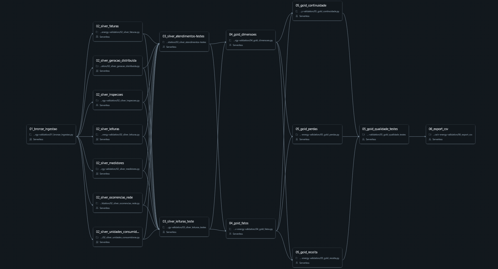
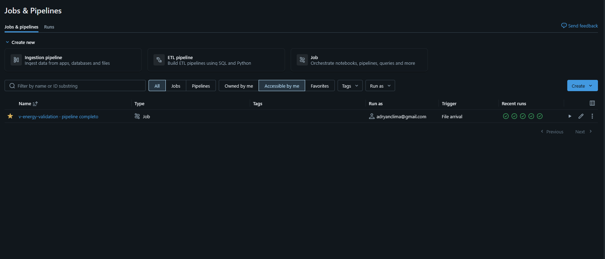

## Job configurado no Databricks
Esse diretório contém o arquivo .yaml referente ao a pipeline de dados presentes no databricks. Que perpassa pelos dados brutos até a camada gold. Atualmente, o pipeline tem agendamento configurado com trigger de entrada de novos arquivos no volume "/Volumes/v-energy/raw_data/raw_data/". Essa estratégia foi escolhida pois o agendamento poderia causar um gargalo no tratamento e atualização dos dados no portal, ao usar um trigger de dados novos, garantimos que os dados que chegam de forma bruta (leituras, medidores, etc) sejam imediatamente tratados e implementados na camada gold.

## Evidências do job no ambiente DataBricks

## Considerações finais
Como é nítido a partir das evidências, o job está configurado com um trigger adequado, tem estrutura e runs propriamente documentados e suporta múltiplas execuções de ponta a ponta, cumprindo os requisitos do case.