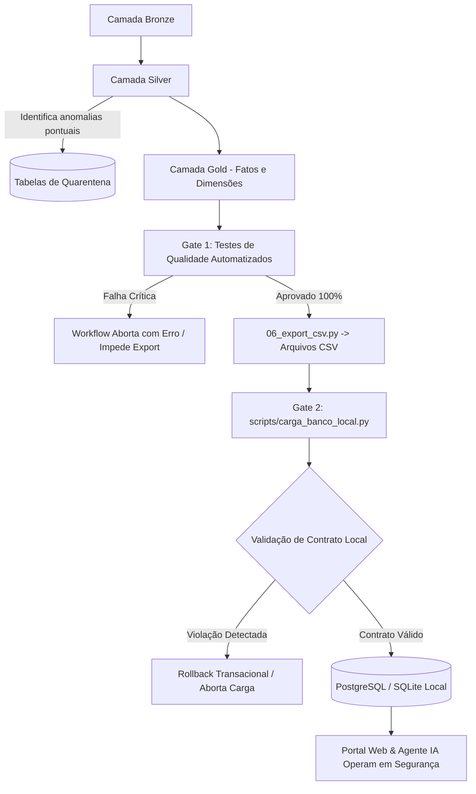

# Relatório e Especificação dos Testes de Qualidade de Dados (Data Quality Gate)

**Projeto:** V-Energy Grid 360  
**Módulo:** Engenharia de Dados (Requisito Diferencial)  
**Referência Arquitetural:** [ADR 0001 - Barreira Dupla de Testes de Qualidade Automatizados](file:///C:/Users/Adryan/Documents/v-energy-grid-360/docs/adr/0001-barreira-dupla-testes-qualidade.md) e [GLOSSARY.md](file:///C:/Users/Adryan/Documents/v-energy-grid-360/GLOSSARY.md)

---

## 1. Visão Geral

O objetivo deste componente é garantir que qualquer falha nos dados gerados no pipeline seja identificada e bloqueada **antes** de chegar ao Portal Web e ao Agente de IA.

A arquitetura opera através de uma **Barreira Dupla (*Two-Gate Quality System*)**:
- **Gate 1 (Databricks Workflow)**: Notebook dedicado `05_gold_qualidade_testes.py` posicionado entre o cálculo da camada Gold e a exportação CSV (`06_export_csv.py`). Falhas críticas disparam exceção (`AssertionError`), interrompendo o Workflow e impedindo que arquivos CSV inválidos sejam criados no volume de saída.
- **Gate 2 (Ingestão Local)**: Verificação transacional em `scripts/carga_banco_local.py` e suíte de testes standalone (`pytest tests/data_engineering/`). Valida esquema, unicidade e integridade referencial antes de efetivar o `COMMIT` no PostgreSQL ou SQLite. Em caso de falha, ocorre `ROLLBACK` automático.

---

## 2. Matriz de Testes do Contrato de Dados da Gold

Os testes automatizados cobrem os 4 eixos essenciais do negócio:

### Eixo 1: Integridade Referencial
Garante a ausência de registros órfãos que possam quebrar gráficos, filtros ou consultas do portal e da IA.

| Tabela Fato / Filha | Coluna FK | Tabela Dimensão / Pai | Coluna PK | Condição Aceitável | Severidade |
|---|---|---|---|---|---|
| `fact_faturamento` | `id_uc` | `dim_unidade_consumidora` | `id_uc` | 0 órfãos | **Crítica (Bloqueante)** |
| `fact_leituras` | `id_uc` | `dim_unidade_consumidora` | `id_uc` | 0 órfãos | **Crítica (Bloqueante)** |
| `fact_ocorrencias` | `id_uc` | `dim_unidade_consumidora` | `id_uc` | 0 órfãos | **Crítica (Bloqueante)** |
| `fact_ocorrencias` | `alimentador` | `dim_alimentador` | `alimentador` | 0 órfãos | **Crítica (Bloqueante)** |
| `fact_atendimentos` | `id_uc` | `dim_unidade_consumidora` | `id_uc` | 0 órfãos | **Crítica (Bloqueante)** |
| `fact_inspecoes` | `id_uc` | `dim_unidade_consumidora` | `id_uc` | 0 órfãos | **Crítica (Bloqueante)** |
| `fila_inspecao` | `id_uc` | `dim_unidade_consumidora` | `id_uc` | 0 órfãos | **Crítica (Bloqueante)** |
| `dim_geracao_distribuida` | `id_uc` | `dim_unidade_consumidora` | `id_uc` | 0 órfãos | **Crítica (Bloqueante)** |

### Eixo 2: Unicidade e Completude (PKs e Campos Obrigatórios)
Garante a estrutura das entidades e a ausência de chaves nulas ou duplicadas.

| Tabela | Coluna(s) | Regra | Condição Aceitável | Severidade |
|---|---|---|---|---|
| `dim_unidade_consumidora` | `id_uc` | Chave Primária | Não nula e 100% única (45.000 registros) | **Crítica (Bloqueante)** |
| `dim_alimentador` | `alimentador` | Chave Primária | Não nula e 100% única (122 alimentadores) | **Crítica (Bloqueante)** |
| `dim_medidor` | `id_medidor` | Chave Primária | Não nula e 100% única | **Crítica (Bloqueante)** |
| `fact_faturamento` | `id_fatura` | Chave Primária | Não nula e 100% única | **Crítica (Bloqueante)** |
| `fact_leituras` | `id_leitura` | Chave Primária | Não nula e 100% única | **Crítica (Bloqueante)** |
| `fact_ocorrencias` | `id_ocorrencia` | Chave Primária | Não nula e 100% única | **Crítica (Bloqueante)** |
| `fact_atendimentos` | `protocolo` | Chave Primária | Não nula e 100% única | **Crítica (Bloqueante)** |
| `fact_inspecoes` | `id_inspecao` | Chave Primária | Não nula e 100% única | **Crítica (Bloqueante)** |
| `fila_inspecao` | `prioridade` | Sequencial Único | Não nula, valores de 1 a N | **Crítica (Bloqueante)** |
| Todas as tabelas | Todas | Volumetria Mínima | Contagem de linhas > 0 | **Crítica (Bloqueante)** |

### Eixo 3: Consistência Contábil e Regras de Negócio
Garante que cálculos tarifários, indicadores regulatórios e métricas de energia estejam matematicamente corretos.

| Tabela | Regra de Domínio | Fórmula / Validação | Tolerância / Condição | Severidade |
|---|---|---|---|---|
| `fact_faturamento` | Balanço Contábil da Fatura | `abs(receita_faturada - (valor_energia + tributos)) <= 0.05` | 100% das faturas | **Crítica (Bloqueante)** |
| `fact_faturamento` | Atraso Não-Negativo | `dias_atraso >= 0` | 100% das faturas | **Crítica (Bloqueante)** |
| `fact_faturamento` | Bandeiras Válidas | `bandeira_tarifaria in ('VERDE', 'AMARELA', 'VERMELHA_P1', 'VERMELHA_P2')` | 0 fora do domínio | **Crítica (Bloqueante)** |
| `agg_continuidade_alimentador` | Indicadores Regulatórios ANEEL | `dec >= 0.0` e `fec >= 0.0` | 100% dos alimentadores | **Crítica (Bloqueante)** |
| `fact_leituras` | Consumo Não-Negativo | `consumo_kwh >= 0.0` | 100% das leituras | **Crítica (Bloqueante)** |
| `dim_geracao_distribuida` | Potência Válida | `potencia_kwp > 0.0` | 100% das conexões GD | **Crítica (Bloqueante)** |
| `fila_inspecao` | Intervalo do Score | `score between 0 and 100` | 100% da fila | **Crítica (Bloqueante)** |

### Eixo 4: Coerência Temporal
Garante que as competências e registros respeitem a janela de concessão dos dados.

| Tabela | Validação Temporal | Intervalo Esperado | Severidade |
|---|---|---|---|
| `dim_competencia` | Cobertura Temporal | Exatamente 48 competências mensais (2022-07 a 2026-06) | **Crítica (Bloqueante)** |
| `fact_faturamento` | Janela de Emissão | `data_emissao` entre 2022-07-01 e 2026-06-30 | **Crítica (Bloqueante)** |
| `fact_faturamento` | Regra de Vencimento | `data_vencimento = data_emissao + 12 dias` | Tolerância 0 violações | **Crítica (Bloqueante)** |
| `fact_leituras` | Data de Medição | Não nula e dentro do período de concessão | **Crítica (Bloqueante)** |
| `fact_ocorrencias` | Duração do Evento | `data_encerramento >= data_abertura` | 0 durações negativas | **Crítica (Bloqueante)** |

---

## 3. Gestão de Severidades e Comportamento Operacional

1. **Falha Crítica (Breaking)**:
   - No Databricks: Lança exceção explícita com mensagem detalhada do teste violado e aborta a execução do Job antes de qualquer escrita no volume de exportação.
   - No Local: Cancela a transação via `ROLLBACK`, apaga arquivos temporários e impede a corrupção do banco operacional.

2. **Anomalia de Registro (Warning/Quarentena)**:
   - Registros da base legada com inconsistências de origem (ex.: UCs órfãs da medição anterior) são desviados para as tabelas `silver_*_quarentena` com o respectivo `motivo_quarentena`, permitindo que os dados válidos componham a Gold com pureza analítica.
