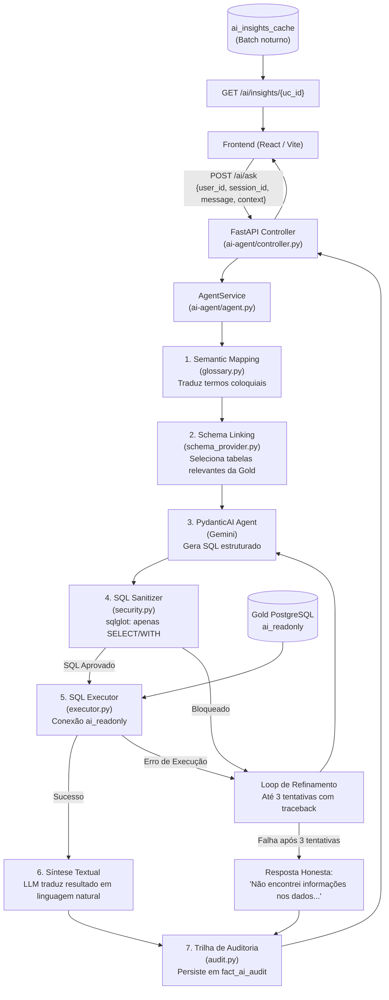

# Planejamento de Arquitetura: Módulo IA Generativa (`ai-agent`)
**Projeto:** V-Energy Grid 360 | Visagio Rocket Lab 2026.2  
**Módulo:** Módulo 3 — Inteligência Artificial (Text-to-SQL & Insights)  
**Status:** Planejamento Consolidado  

---

## 1. Objetivo e Requisitos Atendidos

O objetivo deste módulo é democratizar o acesso aos dados da V-Energy, permitindo que usuários não técnicos (atendentes, analistas e diretores) realizem perguntas em linguagem natural sobre faturamento, consumo, interrupções e rede, recebendo respostas precisas, fundamentadas e auditáveis, além de disponibilizar insights proativos no portal.

### Requisitos Atendidos:
- **REQ-AI-01:** Agente conversacional Text-to-SQL para consultas em português.
- **REQ-AI-02:** Reconhecimento e mapeamento semântico de termos cotidianos (ex: *"conta de luz"*, *"falta de luz"*).
- **REQ-AI-03:** Trilha de auditoria das respostas (pergunta, SQL gerado, resultado, tempo de resposta).
- **REQ-AI-04:** Insights proativos gerados por IA embutidos nas telas do portal (Visão 360).
- **REQ-AI-05:** Acesso ao agente integrado diretamente na plataforma web, sem troca de ferramenta.
- **REQ-AI-06:** Segurança e Integridade: garantia de somente leitura (read-only) e proteção contra Prompt Injection.
- **REQ-AI-07 (Diferencial):** Suporte a perguntas de follow-up preservando o contexto da conversa.
- **REQ-AI-08 (Diferencial):** Avaliação automatizada da qualidade e fidelidade das respostas (Golden Dataset).

---

## 2. Decisões Arquiteturais

| Dimensão | Decisão Adotada | Justificativa / Trade-off |
|---|---|---|
| **Forma de Deploy** | Embutido no backend FastAPI | Módulos Python dentro do projeto chamados diretamente pelos controllers do FastAPI. Evita sobrecarga operacional de gerenciar um microsserviço à parte para a entrega do MVP. |
| **Topologia de Agentes** | Agente Único PydanticAI | Pipeline determinístico em etapas: *Schema Linking $\rightarrow$ SQL Generation $\rightarrow$ Execution & Refinement*. Simplicidade, rapidez e alta previsibilidade. |
| **Framework & Modelo** | PydanticAI + Gemini 2.0 Flash Lite | Tipagem forte com Pydantic, validação estruturada do SQL de saída, baixa latência e baixo custo de inferência por requisição. |
| **Histórico / Follow-up** | `session_id` + `fact_ai_audit` | O frontend envia um `session_id`. O histórico recente é recuperado da tabela de auditoria no PostgreSQL para compor o contexto da conversa. |
| **Loop de Refinamento** | Autocorreção via try/except (até 3 tentativas) | Caso o banco retorne erro de sintaxe SQL, o erro é injetado como contexto para o LLM corrigir a query. Se falhar 3 vezes, aciona a resposta honesta de *"não sei"*. |
| **Segurança e Defesa** | Dupla Camada (App + Banco) | 1. **Aplicação:** Sanitização estática com `sqlglot` bloqueando qualquer comando fora de `SELECT`/`WITH`.<br>2. **Banco:** Usuário PostgreSQL `ai_readonly` com permissão estrita de `SELECT` nas tabelas Gold. |
| **Insights Proativos** | Processamento em Batch (Cache) | Evita lentidão ao abrir as telas de UC. Os insights são pré-calculados em rotina noturna/batch e cacheados em `ai_insights_cache`. |
| **Estratégia de Testes** | Unitários com `pytest` + LLM mockado | Garante testes rápidos no CI/CD sem custo de tokens de API. Inclui um *Golden Dataset* JSON com pares pergunta/SQL para medir precisão (REQ-AI-08). |

---

## 3. Diagrama de Arquitetura e Fluxo de Execução



---

## 4. Estrutura de Arquivos Proposta

```text
ai-agent/
├── README.md                          # Instruções de setup, execução e env vars
├── requirements.txt                   # Dependências isoladas (pydantic-ai, sqlglot, etc.)
├── agent.py                           # Orquestrador do pipeline Text-to-SQL
├── controller.py                      # Router FastAPI (/ai/ask e /ai/insights)
├── schema_provider.py                 # Schema Linking: metadados e colunas da Gold
├── glossary.py                        # Semantic Mapping: tradução de termos coloquiais
├── security.py                        # Validador e sanitizador SQL (sqlglot)
├── executor.py                        # Execução no PostgreSQL com pool ai_readonly
├── audit.py                           # Persistência da auditoria (fact_ai_audit)
├── insights.py                        # Geração de insights em batch e leitura do cache
├── prompts/
│   ├── system_prompt.txt              # System prompt com persona e diretrizes de segurança
│   └── few_shot_examples.json         # Exemplos guiados anti-injection e queries modelo
├── tests/
│   ├── conftest.py                    # Fixtures e mocks para pytest
│   ├── test_security.py               # Testes de bloqueio de SQL malicioso / injection
│   ├── test_agent.py                  # Testes do fluxo do agente (com LLM mockado)
│   ├── test_audit.py                  # Testes de gravação da trilha de auditoria
│   ├── test_insights.py               # Testes de recuperação de insights do cache
│   └── golden_dataset/
│       └── qa_pairs.json              # Perguntas e padrões SQL de referência (REQ-AI-08)
└── migrations/
    └── 001_create_ai_tables.sql       # DDL das tabelas fact_ai_audit e ai_insights_cache
```

---

## 5. Detalhamento dos Componentes

### 5.1 Banco de Dados & Migrações (`migrations/001_create_ai_tables.sql`)
Cria a infraestrutura necessária para auditoria e performance de insights:
- `fact_ai_audit`: registra `audit_id`, `session_id`, `user_id`, `question`, `sql_generated`, `result_preview`, `answer`, `page_context`, `uc_context`, `attempt_count` e `response_ms`.
- `ai_insights_cache`: armazena `uc_id`, `insight` gerado e `generated_at`.
- Usuário `ai_readonly`: permissão exclusiva de `SELECT` nas tabelas da camada Gold.

### 5.2 Camada de Defesa e Segurança (`security.py`)
- Utiliza a biblioteca `sqlglot` para fazer o parsing estático da query gerada pelo LLM.
- Garante que a AST (árvore sintática) contenha unicamente instruções do tipo `Select`.
- Bloqueia proativamente palavras-chave como `INSERT`, `UPDATE`, `DELETE`, `DROP`, `ALTER`, `TRUNCATE`, `EXECUTE` e múltiplos statements encadeados.

### 5.3 Mapeamento Semântico (`glossary.py`)
Dicionário injetado no prompt para resolver termos usuais:
- *"conta de luz"* $\rightarrow$ `fact_faturamento`
- *"falta de luz"* / *"blecaute"* $\rightarrow$ `fact_ocorrencias`
- *"cliente"* $\rightarrow$ `dim_unidade_consumidora`
- *"preço médio"* $\rightarrow$ `receita / volume_faturado`

### 5.4 Schema Linking Dinâmico (`schema_provider.py`)
- Em vez de enviar o DDL completo de todo o banco para o LLM a cada chamada, filtra e fornece apenas as tabelas e colunas que guardam relação com as palavras-chave da dúvida do usuário.
- Reduz o consumo de tokens e diminui drasticamente o risco de o LLM tentar juntar tabelas irrelevantes.

### 5.5 Pipeline Text-to-SQL e Síntese (`agent.py`)
- Emprega o `PydanticAI` com schema de saída estrito (`SQLResponse`).
- Em caso de falha de execução no PostgreSQL, captura o erro e realiza até 3 re-tentativas passando o erro como feedback.
- Caso não consiga gerar uma query válida ou se a pergunta estiver fora de escopo, retorna estritamente a mensagem honesta: *"Sinto muito, mas não encontrei informações nos dados para responder a essa pergunta."*

### 5.6 Integração HTTP (`controller.py`)
- Endpoint `POST /ai/ask`: recebe `user_id`, `session_id`, `message` e o objeto opcional `context` (`page`, `current_uc_id`).
- Endpoint `GET /ai/insights/{uc_id}`: lê diretamente da tabela de cache, respondendo em milissegundos sem acionar o LLM em tempo de requisição.

---

## 6. Estratégia de Testes e Avaliação

1. **Testes Unitários de Segurança (`test_security.py`):**
   - Valida que comandos maliciosos (`DROP TABLE`, `DELETE`, injects SQL) são rejeitados antes de qualquer conexão ao banco.
2. **Testes de Fluxo com Mocks (`test_agent.py`):**
   - Valida que o agente orquestra os 7 passos corretamente, simulando respostas do modelo para execução rápida e determinística no pipeline de integração contínua.
3. **Avaliação com Golden Dataset (`test_evaluation.py`):**
   - Mede a taxa de acerto do agente sobre 10 a 15 perguntas formuladas a partir das user stories das lideranças da V-Energy (Diretoria Comercial, Atendimento, Perdas e Operação).

---

## 7. Rastreabilidade com o Git Flow da Equipe

Seguindo as regras estabelecidas pelo time:
1. Esta documentação foi versionada na branch de documentação: `docs/planejamento-ai-agent`.
2. A implementação do código será feita na branch `feat/ai-agent`, criada a partir da `dev`.
3. Os commits seguirão mensagens semânticas por componente (`feat(ai-agent): security`, `test(ai-agent): unit tests`, etc.).
4. A integração final será via **Pull Request (PR)** direcionado à branch `dev`, necessitando do quórum mínimo de 2 aprovações da equipe antes do merge.
